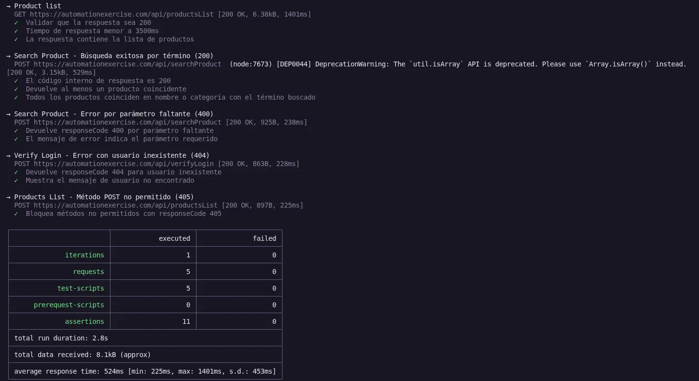
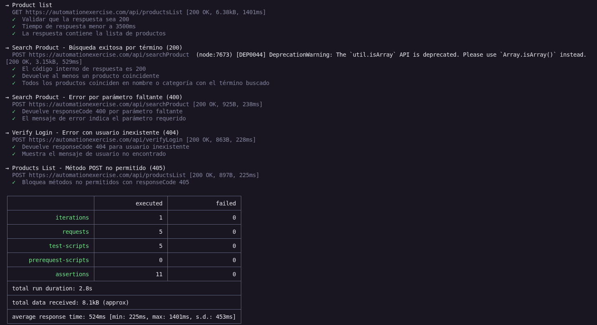
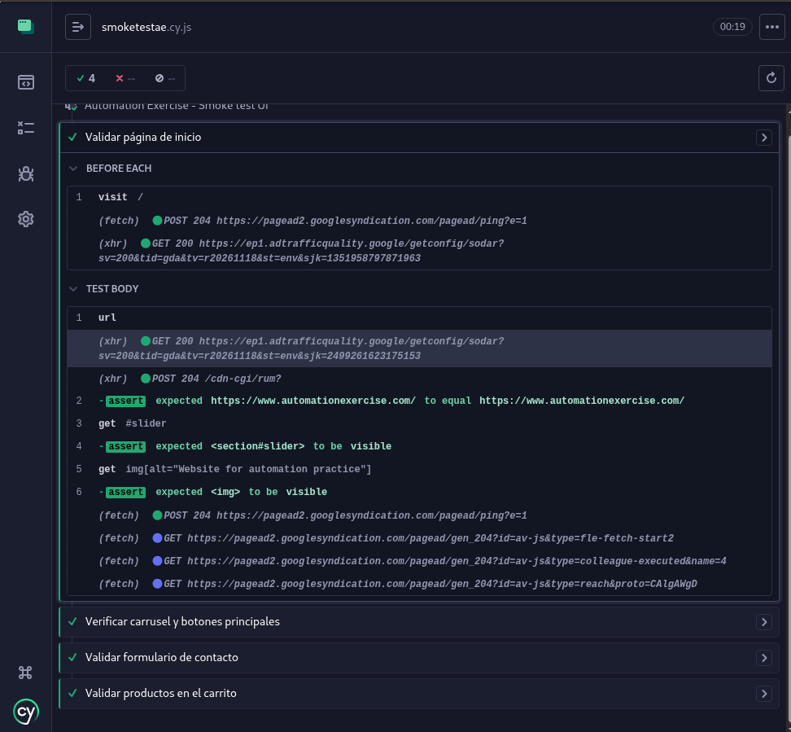
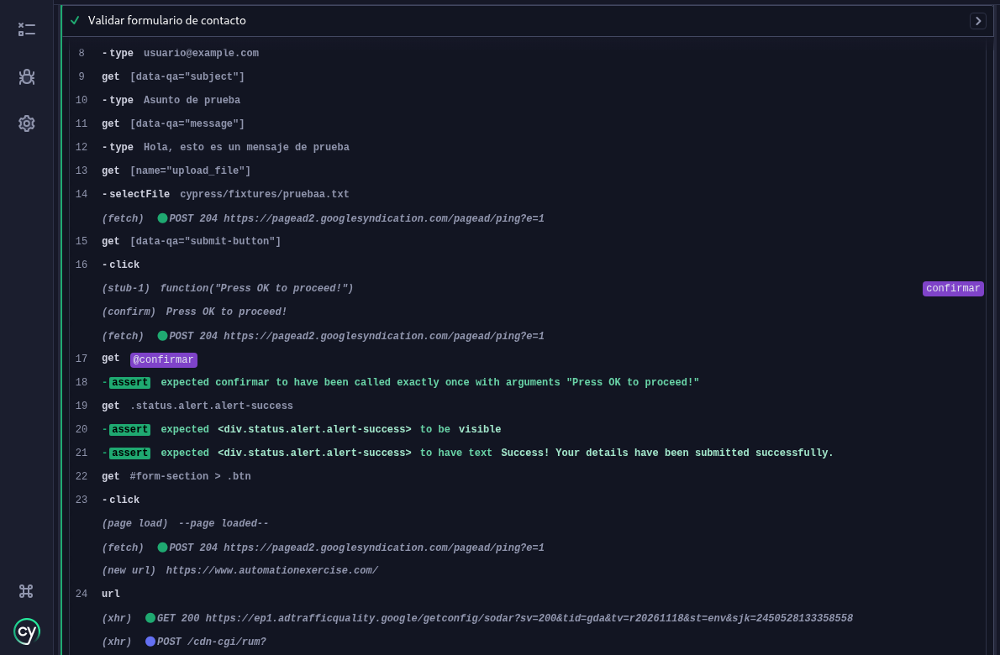
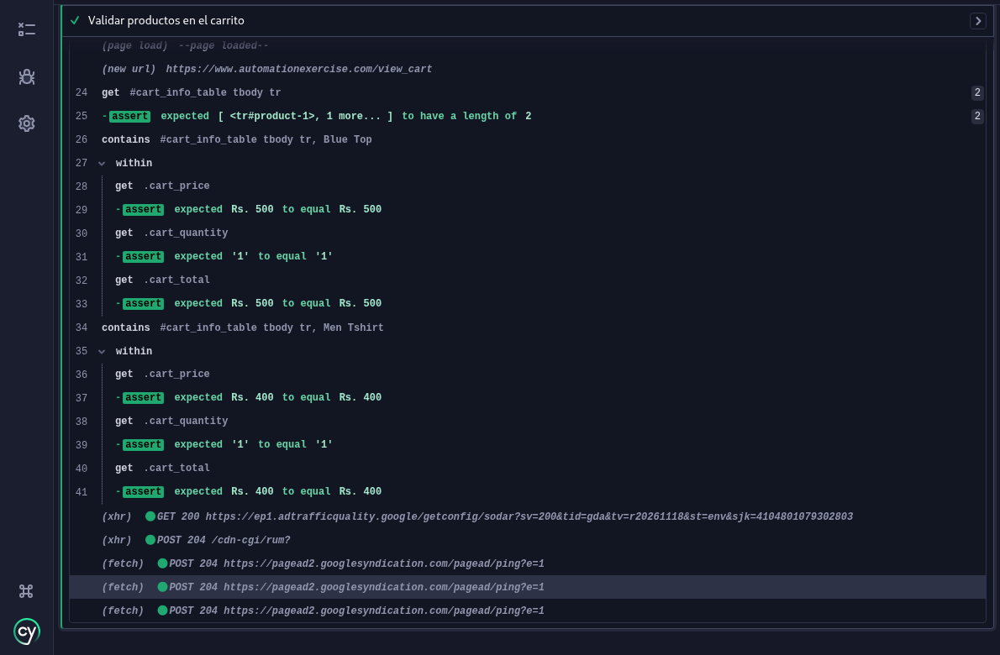

# Automation Exercise: pruebas de UI y API

Proyecto de práctica de QA sobre [Automation Exercise](https://automationexercise.com/), una plataforma que no desarrollé. Incluye un smoke test de interfaz con Cypress y JavaScript, y pruebas de API con Postman y Newman.

## Estructura

```text
Cypress-test-AE/
├── cypress/
│   ├── e2e/
│   │   └── smoketestae.cy.js           # Tests de interfaz
│   ├── fixtures/
│   │   └── pruebaa.txt                 # Adjunto del formulario
│   └── support/
│       ├── commands.js                 # Plantilla sin comandos personalizados
│       └── e2e.js                      # Archivo de soporte
├── evidencias/
│   ├── cypress-ui-carrito.png
│   ├── cypress-ui-contacto.png
│   ├── cypress-ui-resumen.png
│   ├── newman-api-falla-503.png
│   └── newman-api-ok.png
│   └── cypress-ui-terminal
├── postman/
│   └── ae-api.postman_collection.json  # Colección de API
├── .gitignore
├── cypress.config.js
├── package-lock.json
├── package.json
└── README.md
```

## Cobertura

### Interfaz (Cypress)

| Caso | Qué valida |
|---|---|
| Página de inicio | URL, visibilidad del slider y de una imagen |
| Carrusel | Cambio del slide activo y botones "Test Cases" y "APIs list for practice" |
| Formulario de contacto | Envío con adjunto, diálogo de confirmación, mensaje de éxito y regreso al inicio |
| Carrito | Dos productos, con precio, cantidad (1) y total esperados por fila |

El carrusel puede avanzar automáticamente, por lo que el test no demuestra que el cambio se deba solo al clic.

### API (Postman / Newman)

5 requests y 11 aserciones. `responseCode` es un campo del cuerpo JSON, distinto del estado HTTP.

| Endpoint | Método | Escenario | Validaciones |
|---|---|---|---|
| `/api/productsList` | GET | Listado de productos | Estado HTTP 200, respuesta en menos de 3500 ms y lista `products` no vacía |
| `/api/searchProduct` | POST | Búsqueda de `top` | `responseCode` 200, resultados no vacíos y coincidencia en nombre o categoría |
| `/api/searchProduct` | POST | Falta el parámetro de búsqueda | `responseCode` 400 y mensaje de error |
| `/api/verifyLogin` | POST | Usuario inexistente | `responseCode` 404 y mensaje de error |
| `/api/productsList` | POST | Método no soportado | `responseCode` 405 y mensaje de error |

## Reintentos

En `cypress run`, cada test fallido se puede reintentar hasta 2 veces. En modo interactivo no hay reintentos. Los reintentos aplican a fallas de cualquier causa y pueden indicar inestabilidad, por lo que conviene revisarlos.

## Requisitos

- Node.js `^22.0.0`, `^24.0.0` o `>=26.0.0`
- npm
- Google Chrome o Firefox
- Conexión a internet

## Instalación

```bash
git clone https://github.com/Ivess21/Cypress-test-AE.git
cd Cypress-test-AE
npm ci
npx cypress install
```

## Ejecución

| Comando | Qué ejecuta |
|---|---|
| `npm run pruebas-chrome` | Interfaz en Chrome |
| `npm run pruebas-firefox` | Interfaz en Firefox |
| `npm run pruebas-api` | API con Newman |
| `npm test` | Interfaz en Chrome y, si pasa, API |

## Evidencia de ejecución

### API (Newman), 27/11/2026

**Corrida exitosa:** 5 requests y 11 aserciones ejecutadas, sin fallas.



**Incidente observado en la corrida anterior:** 2 scripts fallaron con `JSONError` y se ejecutaron solo 6 de las 11 aserciones. La request sin el parámetro de búsqueda respondió `503 Service Unavailable`. La corrida siguiente pasó; la causa no está determinada.



### Interfaz (Cypress Test Runner)

Smoke test de interfaz: **4 tests aprobados y 0 fallidos**.



**Formulario de contacto:** validación del diálogo de confirmación y del mensaje de éxito.



**Carrito:** validación de productos, precios, cantidades y totales por fila.



## Autor

**Ives Agustín Acosta**, estudiante de Ingeniería en Sistemas (UTN FRC) y QA Tester Jr. en formación.

[GitHub](https://github.com/Ivess21)
